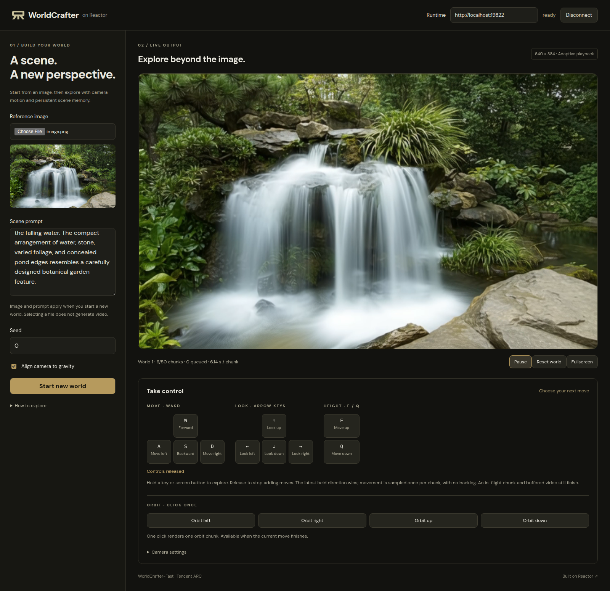

# WorldCrafter-Fast on Reactor

Explore an uploaded scene in [WorldCrafter](https://github.com/TencentARC/WorldCrafter)
with image-conditioned video, camera controls and persistent scene memory,
powered by [Reactor](https://reactor.inc). The included browser demo lets you
choose an image and scene prompt, start a world, and explore it one camera move
at a time. This adapter streams native 33-frame chunks through
Reactor's `main_video` track and supports one GPU or eight GPUs on one host.
The eight-GPU configuration uses WorldCrafter's context-parallel DiT, fused
KV/RoPE path, geometry cache and eight-GPU VAE pipeline.



*The browser demo after six generated chunks with an uploaded waterfall image. Select your own image and prompt to start.*

The adapter uses Reactor Runtime **3.8.3**. WorldCrafter runs in a separate
Python **3.11** / NumPy **1** environment because the Runtime requires Python
**3.12** / NumPy **2**. Communication stays on a private local Unix socket;
frames cross as uint8 RGB NumPy arrays without pickle. An eight-GPU worker
uses the pinned upstream `torchrun` topology; it is not nested inside a
second distributed launcher. Everything the worker prints, including its
tracebacks, is forwarded to the Runtime's log under `worldcrafter.worker`.

## Versions and preparation

- Source: `TencentARC/WorldCrafter@11712fe3a3f42cc448c10713a0b0ff79066e5935`.
- GeoCalib checkpoint: `geocalib-pinhole.tar` from the `cvg/GeoCalib` `v1.0`
  release, pinned by SHA-256.
- Weights: `TencentARC/WorldCrafter-Fast@d2ac12a654f8cafde4cb2e0ae7d5127ce2624939`.
- The upstream `uvenv/uv.lock` defines the inference environment, including CUDA 12.8 PyTorch.
- One generation occupies the configured GPU group; eight GPUs do not imply eight concurrent worlds.

Use a Linux GPU host with Docker, NVIDIA Container Toolkit and the
[Reactor CLI](https://docs.reactor.inc/deploy/development/local-testing).
Reserve at least 200 GB for the pinned weights and additional space for the
image, compilation cache and recordings. From this folder:

```bash
reactor validate
reactor build
reactor run --gpus all --port 8090
```

The image contains the pinned source and its frozen inference environment at
`/opt/worldcrafter`. `prepare.sh` installs them during the build, and the build
stages the hash-checked GeoCalib checkpoint under `/opt/worldcrafter/torch`,
where calibration reads it, so calibration downloads nothing at run time. The
build does not download weights. Reactor resolves the pinned `hf://` URI in `reactor.yaml`,
mounts the weights separately and exposes them through `get_weights_path()`.
To download or update a local checkpoint to the same pinned revision, then reuse it:

```bash
hf download TencentARC/WorldCrafter-Fast \
  --revision d2ac12a654f8cafde4cb2e0ae7d5127ce2624939 \
  --local-dir /absolute/path/WorldCrafter-Fast
reactor run --gpus all --port 8090 --weights /absolute/path/WorldCrafter-Fast
```

The adapter checks every required file against `weights-manifest.json`, whose
sizes and SHA-256 hashes correspond to the pinned upstream snapshot, and checks
the GeoCalib checkpoint against its pinned hash. Every
Runtime load hashes the complete checkpoint and writes an audit receipt to
local scratch after success. Missing, truncated or corrupted files fail before
GPU loading; repair partial checkpoints before retrying. Sessions reuse the
resident model without loading or hashing the weights again.
The checkpoint directory is never modified by validation.

Loading ends with a warmup: the worker generates `warmup_chunks` chunks (two
by default, set in `worldcrafter.yaml`) of a throwaway world and runs GeoCalib
once before it reports ready, so compilation is paid before `/health` reports
`state: available` rather than on a client's first chunk. `timeout_seconds`
bounds that startup; each later call to the worker must answer within 180
seconds. A worker that fails, times out or disconnects serves no further calls.
The adapter attempts one replacement and broadcasts a `state_update` with a new
world ID, zero completed chunks and `paused: true`. Exploration history and
queued motion are discarded because the worker's scene memory is lost; the
selected image, prompt and seed are retained. After replacement, send `resume`
or `reset` to generate a fresh anchor, or `start_world` to select another image.
Other viewers remain connected. If replacement itself fails, the Runtime exits
with an error rather than repeatedly restarting. Session cleanup also replaces
a worker that fails during reset.

Eight GPUs are the default. For a single-GPU smoke test set
`-e WORLDCRAFTER_GPUS=1` on `reactor run`. Supported counts are
one and eight. Compilation defaults on; `WORLDCRAFTER_COMPILE=0` disables it
for diagnosis. `/health` must report `state: available` before connecting.
Caches and scratch use `/local-ssd`; provide a writable local disk there.

`reactor.yaml` requests eight H200 GPUs for hosted deployment. Local execution
uses the GPUs visible to the container. Hosted access and resource allocation
must be arranged with Reactor; a local build does not provision a hosted model.

## Open the browser demo

You need Node.js 20.19+ or 22.12+. In a second terminal, from this folder:

```bash
cd demo
npm ci
npm run dev
```

Open the printed URL (normally `http://localhost:5173`). Set **Runtime** to
`http://localhost:8090` and click **Connect**. Choose a PNG, JPEG or WebP,
then click **Start world** with the prefilled scene prompt, or edit the prompt
to describe your image more precisely. Connecting and selecting an image do
not generate video. There is no default image.

The first 33-frame chunk is stationary. Hold **W / A / S / D** to move,
**arrow keys** to look around, and **E / Q** to rise or descend. The on-screen
direction pads support holding with a mouse or touch. Release to stop requesting
movement; an in-flight chunk and already-buffered video still finish.

The demo sends one move at a time and samples the latest held direction when
the previous chunk completes. Multiple held keys use the most recently pressed
direction: the native model supports one camera action per chunk. Keys are
cleared on pause, window blur or entering a text field. **Escape** releases all
controls. The four **Orbit** buttons stay visible below the direction pads:
click once to generate one left, right, up or down orbit chunk. Holding an orbit
button does not repeat it; these buttons wait for the current move to finish.
**Camera settings** contains distance and angle adjustments.
The SDK also supports explicitly queuing several chunks through `move`.

**Pause** stops future generation; already-buffered video can still play.
**Resume** continues pending motion. **Reset world** reuses the active image,
prompt and seed. **Start new world** uses the form's current inputs and clears
the exploration history. Prompt edits apply to a new world; live prompt editing
is not exposed by this adapter. Playback uses Runtime's adaptive pacing, with
no fixed FPS declared by the model.

### Using a remote GPU host

The browser needs both HTTP and WebRTC connectivity. With SSH, forward the
frontend and Runtime TCP ports, for example:

```bash
ssh -N -L 5173:127.0.0.1:5173 -L 8090:127.0.0.1:8090 user@gpu-host
```

Open `http://localhost:5173` and keep the Runtime endpoint on
`http://localhost:8090`. These two forwards carry the page and commands only.
For media over SSH, configure an authenticated TURN-over-TCP relay using the
Runtime's supported ICE configuration and also forward its TCP listener.
Docker host networking alone does not make SSH carry UDP. Do not expose an
unauthenticated TURN relay or put credentials into the frontend. See
[Reactor local testing](https://docs.reactor.inc/deploy/development/local-testing).

The demo connects to a local Runtime. A hosted deployment additionally needs
server-side exchange of a Reactor API key for a session token; changing the
endpoint alone does not configure hosted authentication.

### Direct Runtime development

The reproducible deployment path is `reactor build` / `reactor run` above.
For direct Runtime development, use separate Python 3.12 and Python 3.11
environments and the asset preparation steps in `reactor.yaml`.
`prepare.sh` stages the pinned public source atomically and runs
`uv sync --frozen`. It refuses to overwrite an unrecognized nonempty source
directory. `WORLDCRAFTER_SOURCE` and `WORLDCRAFTER_PYTHON` can select prepared
absolute paths; `WORLDCRAFTER_WEIGHTS` explicitly overrides the Runtime's
weight path. Use standard Hugging Face authentication when needed; never put
credentials in the model folder.

## Commands

| Command | Input | Behavior |
| --- | --- | --- |
| `start_world` | Uploaded image, nonempty scene prompt, seed, `gravity_align` | Starts a fresh world and emits one stationary chunk. |
| `move` | `action`, `amount`, `chunks` | Queues one to eight camera chunks. |
| `pause` | None | Pauses before the next chunk; the in-flight chunk may finish. |
| `resume` | None | Continues queued motion. |
| `reset` | None | Clears exploration history and restarts the selected image and seed. |

Translate with `forward`, `backward`, `left`, `right`, `up`, `down` (0.1–5
units per chunk). Rotate with `yaw_left`, `yaw_right`, `pitch_up`, `pitch_down`,
`orbit_left`, `orbit_right`, `orbit_up`, `orbit_down` (0.1–45 degrees per chunk).
Orbit radius is two world units. Commands are sampled at chunk boundaries.
At most 16 chunks may be queued; a world is limited to 50 chunks.

Include the desired first- or third-person perspective in the scene prompt.
Gravity alignment defaults on for each new image: GeoCalib estimates the
full gravity vector, yaw and horizontal orbit use that axis, and calibration
failure falls back to unaligned controls. No uncertainty threshold blocks
exploration. Session end clears image, trajectory and model history; loaded
weights remain resident for the next session.

Viewers share one rollout and motion queue. Disconnecting one viewer does not
pause it or discard accepted actions. Runtime suspends generation when no
viewers remain and owns session teardown. Upload validation runs off the event
loop; the original encoded image crosses to the worker, where full-resolution
EXIF-corrected RGB is calibrated before native generation preprocessing.

`process_input()` plans cumulative camera poses on the CPU. Immutable step
inputs carry float32 local and world c2w arrays to the inference worker; the
worker executes those poses without interpreting actions. Gravity is returned
with the stationary anchor and applied before planning subsequent motion.

Accepted commands return their typed result. `state_update` reports queue and
world state. `chunk_generated` reports the chunk, runtime-measured duration,
camera endpoint and participating GPU count. Playout follows generation: each
chunk's 33 frames play over the time the chunk took to generate.
Each model frame carries `world_id`, `chunk_index` and zero-based `frame_index`
metadata. These identify frames across resets and distinguish repeated pacer
frames from new model output, including completely dark frames.

## Test with an actual client

The browser demo was exercised on one B200 for ten consecutive chunks in one
world, followed by pause/resume and reset. A separate local SDK run received
and decoded all 363 frames from ten chunks plus a reset anchor with controlled
20 Mbps transport limits. Default adaptive WebRTC transport can drop individual
frames; a completion message alone does not prove complete media delivery.
The existing 55 CPU tests, schema rendering and frontend production build pass.

Install the pinned client and test dependencies in a Python 3.12 environment
with `pip install -r requirements-dev.txt`, then:

```bash
python validate_client.py --url http://127.0.0.1:8090 \
  --image /absolute/path/image.png --prompt /absolute/path/prompt.txt \
  --gpus 8 --full --multi-viewer --output /absolute/path/validation
```

The client uploads the image through Reactor, receives WebRTC frames, explores
forward and turns left/right, resets the world, checks camera poses, and saves
a decoded MP4 and a JSON report. It requires all 33 tagged frames for every
announced chunk, including the reset world; missing or unexpected frames fail
validation. Untagged Runtime connection/flush frames are excluded by identity,
not brightness. Repeated tagged pacer frames are counted once. `--multi-viewer`
also connects a second viewer, queues four chunks while paused, resumes and
disconnects that viewer during the rollout. The remaining viewer must receive
all four chunks without another resume. `--media-timeout` bounds delivery wait
after completion; failures save a report listing the missing frame identities.
A remote browser needs working WebRTC connectivity (host candidates or an
appropriate TURN relay); forwarding the HTTP port alone does not establish
video connectivity.

Contract tests do not require model weights:

```bash
python -m reactor_runtime.schema --path . --out /tmp/worldcrafter-schema.json
PYTHONPATH=. python -m pytest tests/ -q
```

## Credits

Thanks to [Drexubery](https://github.com/Drexubery) and the WorldCrafter team
for the model and the [Reactor Cookbook integration](https://github.com/reactor-team/reactor-cookbook/pull/75),
and to [Rising0321](https://github.com/Rising0321) for the browser demo and upstream packaging.

## License

The Reactor adapter retains the Cookbook's [Apache-2.0 license](LICENSE).
WorldCrafter code and weights retain their upstream academic-use license and
third-party notices. The source is included in the built image and weights are mounted
separately; neither is relicensed by this adapter. See [the upstream license](https://github.com/TencentARC/WorldCrafter/blob/11712fe3a3f42cc448c10713a0b0ff79066e5935/LICENSE.txt).

[Project](https://drexubery.github.io/WorldCrafter/) ·
[Source](https://github.com/TencentARC/WorldCrafter) ·
[Weights](https://huggingface.co/TencentARC/WorldCrafter-Fast) ·
[Reactor authoring guidelines](https://github.com/reactor-team/reactor-cookbook/blob/main/GUIDELINES.md)
